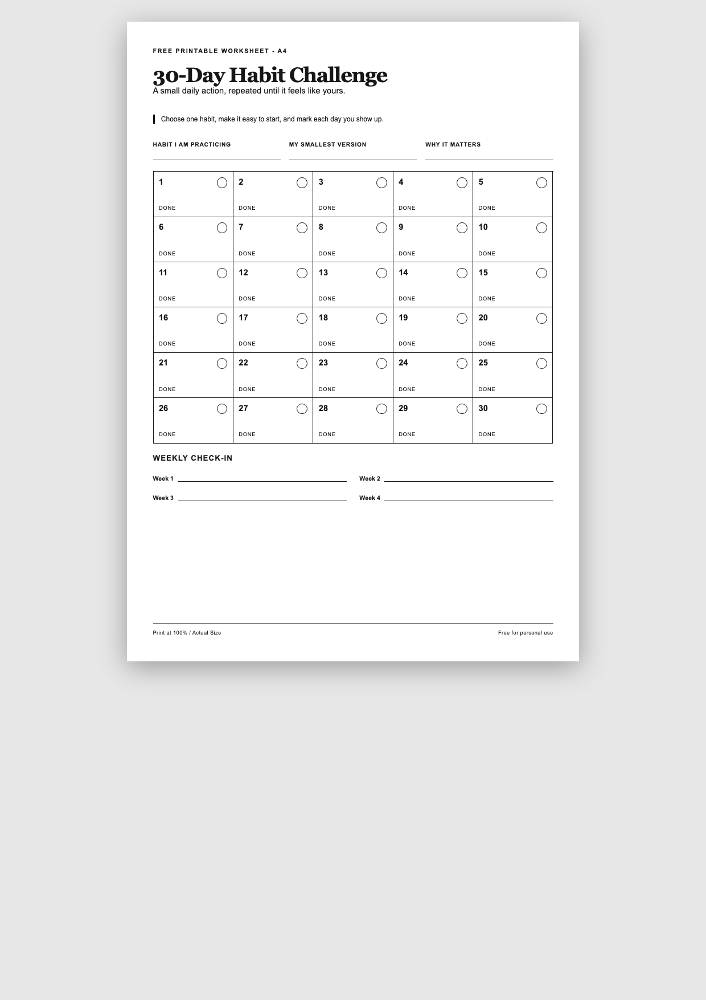

# Printable Goal Trackers

Free, printer-friendly goal trackers and challenges in A4 and US Letter.

| Template | A4 | US Letter |
| --- | --- | --- |
| 30-Day Habit Challenge | [PDF](templates/30-day-habit-challenge/A4.pdf) | [PDF](templates/30-day-habit-challenge/US-Letter.pdf) |
| 2027 Goals Tracker | [PDF](templates/2027-goals-tracker/A4.pdf) | [PDF](templates/2027-goals-tracker/US-Letter.pdf) |
| 7-Day Declutter Challenge | [PDF](templates/7-day-declutter-challenge/A4.pdf) | [PDF](templates/7-day-declutter-challenge/US-Letter.pdf) |
| Reading Challenge | [PDF](templates/reading-challenge/A4.pdf) | [PDF](templates/reading-challenge/US-Letter.pdf) |



Print at **100% / Actual Size**. A4 is 210 x 297 mm; US Letter is 8.5 x 11 in.

```sh
npm install && npx playwright install chromium
npm run build && npm test && npm run verify
```

Code is [MIT licensed](LICENSE); original worksheet content is [CC BY 4.0](CONTENT-LICENSE.md). See [CONTRIBUTING.md](CONTRIBUTING.md). Want a custom plan? [Create one on CutDone](https://cutdone.com/?utm_source=github&utm_medium=referral&utm_campaign=printable_goal_trackers&utm_content=readme).
